# ⚡ Rajana Durga Pavan Kumar — AI & ML Engineering Portfolio

[](https://github.com/DurgaPavan0923/pavan_portfolio-main/actions/workflows/ci.yml)
[](https://nextjs.org/)
[](https://react.dev/)
[](https://www.typescriptlang.org/)
[](https://tailwindcss.com/)
[](https://swr.vercel.app/)
[](LICENSE)

A recruiter-first, interview-defensible engineering portfolio built with **Next.js 15 App Router**, **React 19**, **TypeScript**, **Tailwind CSS**, and **SWR**. Designed under a strict empirical rule: **every number, claim, and technology on the site is backed by code, an empirical benchmark, or a document in this repository**.

🌐 **Live Production Deployment:** [https://pavan-portfolio-gamma-six.vercel.app/](https://pavan-portfolio-gamma-six.vercel.app/)

---

## 🏗️ System Architecture & Data Flow

```mermaid
flowchart TD
    subgraph Client ["Client Layer (Desktop / Tablet / Mobile 360px-1920px)"]
        Browser["Next.js 15 Client"]
        CmdK["Command Palette (⌘K)"]
        Marquee["Moments 22-Photo Infinite Marquee"]
        Lightbox["Accessible Lightbox Modal"]
        ChatWidget["AI Assistant Chatbot"]
        SWRHook["SWR Client Hook (5m Interval, Focus Revalidation)"]
    end

    subgraph Server ["Serverless Next.js App Router (Dynamic & ISR)"]
        Page["Static & ISR Server Shell"]
        APIChat["/api/chat (Gemini API Streaming)"]
        APIGitHub["/api/github (Dynamic Handler, ISR: 900s)"]
        APIRevalidate["/api/revalidate (On-Demand Webhook)"]
        APIContact["/api/contact (Resend & Gmail SMTP)"]
    end

    subgraph Telemetry ["Live GitHub Telemetry Pipeline"]
        GraphQL["GitHub GraphQL API (Explicit from/to)"]
        MirrorScraper["Public Mirror / HTML Scraper"]
        LocalSnapshot["src/data/github-snapshot.json (Cached Fallback)"]
        CronWorkflow[".github/workflows/refresh-github-snapshot.yml (Every 6h)"]
    end

    subgraph Data ["Empirical Machine Learning Evaluations (/evals/)"]
        EvalsFactLens["evals/factlens-ai (Graph RAG n=100)"]
        EvalsInsight["evals/insight-ai (ATS Matching n=32)"]
        EvalsWater["evals/underwater-analytics (TIH IIT Guwahati N=656)"]
        EvalsSeq2Seq["evals/seq2seq-summarizer (CNN/DM n=50)"]
    end

    subgraph External ["External Services & Verification"]
        GeminiAPI["Google Gemini 2.5 Flash"]
        ResendAPI["Resend / Nodemailer Gmail"]
    end

    Browser --> Page
    CmdK --> Page
    Marquee --> Lightbox
    ChatWidget --> APIChat
    APIChat --> GeminiAPI
    SWRHook --> APIGitHub

    APIGitHub -->|Primary: GITHUB_TOKEN| GraphQL
    APIGitHub -.->|Fallback 1: Rate Limit| MirrorScraper
    APIGitHub -.->|Fallback 2: Network Error| LocalSnapshot
    CronWorkflow -->|Refreshes Every 6h| LocalSnapshot
    APIRevalidate -->|Instant Invalidation| APIGitHub

    APIContact --> ResendAPI
    Page --> EvalsFactLens
    Page --> EvalsInsight
    Page --> EvalsWater
    Page --> EvalsSeq2Seq
```



---

## 🧭 Recruiter-First Sequential Layout

The visual layout, navigation dock, Command Palette (⌘K), mobile menu, and scroll-spy strictly adhere to an intuitive recruiter review sequence:

| Step | Section Name | Description & Proof Point |
| :---: | :--- | :--- |
| **01** | **Hero** | 1-line value proposition, 3 primary CTAs (*View Projects*, *Download Resume*, *Contact*), concise About block, Currently strip, and 4 derived stats (23 public repos, 7 projects built, 98 GCP badges, 9 certifications). |
| **02** | **Featured Projects** | 3 flagship evaluated systems with empirical benchmarks (**FactLens AI**, **InsightAI**, **Underwater Environmental Analytics**) + compact secondary systems (**Seq2Seq Summarizer**, **IRA**, **AGORA**, **Algorithm Arena**, **SOA NCC**). Explicit limitations disclosed on every card. |
| **03** | **Internships, Research & Roles** | Hands-on engineering roles with exactly 3 bullets per role ("Built X using Y → outcome/learning"): **TIH IIT Guwahati**, **GDGoC ITER**, **Edunet IBM SkillsBuild**, **Microsoft Elevate**, **InternPro**, **Cognizance IIT Roorkee**. |
| **04** | **GitHub Telemetry & Contributions** | Real-time GitHub telemetry via GraphQL for user `DurgaPavan0923`: 23 repos, 258 contributions, verified merged PRs subpanel, streak calculator, language breakdown, and 52-week heatmap. |
| **05** | **Technical Skills** | 4 balanced competency groups in a clean 2x2 grid (24 items total): **Machine Learning**, **Generative AI**, **AI Engineering**, **Full-Stack & Cloud**. |
| **06** | **Education & Certifications** | Formal B.Tech CSE degree card at SOA ITER (Class of 2027) and verifiable industry credentials (Neo4j Certified ID `178619623`, GCP 98 Badges, etc.) without unverified numbers or external portal links. |
| **07** | **Leadership & Achievements** | Certified NCC Sergeant service (Alpha/Bravo grades), Rajya Puraskar Awardee (Scouts & Guides), School Captain, and symposium leadership. |
| **08** | **Moments & Highlights** | Curated 13-photo de-duplicated GPU-accelerated infinite marquee with pause on hover/touch, keyboard navigation, and responsive lightbox modal (88vw/78vh on mobile, 780px on desktop with body scroll lock). |
| **09** | **Contact & Collaboration** | Resilient contact form with rate limiting, honeypot spam filter, and one-click email copy button to `rdpkumar2308@gmail.com`. |

---

## 📊 Empirical Evaluations Summary (`/evals/`)

Every featured project includes reproducible benchmark scripts and datasets located in `/evals/<project>/`. All evaluation scripts are designed with zero third-party pip dependencies, executing deterministically on vanilla Python standard libraries:

| Project | Dataset | Sample Size | Primary Metrics Produced | Latency (p50) | Status |
| :--- | :--- | :---: | :--- | :---: | :---: |
| **FactLens AI** | FEVER / LIAR Claim Sample | $n=100$ | **Accuracy: 94.0%**<br>Macro-F1: 0.9400<br>*(vs. Baseline: 35.0%, Zero-Shot: 87.0%)* | 8.99 ms | ✅ Published |
| **InsightAI ATS** | Synthetic Resume–JD Matching | $n=32$ | **Precision@1: 100.0%**<br>Precision@3: 66.7%<br>NDCG@3: 0.9955 | 0.197 ms | ✅ Published |
| **Underwater Analytics** | Quarantined Lockbox & CTD Stream | $N=656$<br>Stream: $N=720$ | **PR-AUC: 0.5951** *(vs. WHO rule: 0.3920)*<br>ROC-AUC: 0.6689, Brier: 0.2154<br>DO Forecaster MAE: 0.1748 *(vs. 0.2980)* | 2.89 ms | ✅ Published |
| **News Summarizer** | CNN/DailyMail Test Articles | $n=50$ | **ROUGE-1: 0.5550**<br>ROUGE-2: 0.2801<br>ROUGE-L: 0.4281 *(Lead-3 Baseline)* | 0.148 ms | ✅ Published *(Secondary / Weights Pending)* |

---

## 🏃 Running Evaluation Scripts Locally

You can run each evaluation script directly from the repository root using standard Python 3:

### 1. FactLens AI Graph RAG Evaluation
```bash
python evals/factlens-ai/evaluate.py
```

### 2. InsightAI ATS Semantic Matching Evaluation
```bash
python evals/insight-ai/evaluate.py
```

### 3. Underwater Environmental Analytics Evaluation
```bash
python evals/underwater-analytics/evaluate.py
```

### 4. Seq2Seq News Summarizer Evaluation
```bash
python evals/seq2seq-summarizer/evaluate.py
```

---

## 💻 Local Development, Testing & Telemetry

### 1. Prerequisites
- **Node.js**: `v20.x` or higher
- **npm**: `v10.x` or higher
- **Python**: `3.10+` (for running evals)

### 2. Installation
```bash
git clone https://github.com/DurgaPavan0923/pavan_portfolio-main.git
cd pavan_portfolio-main
npm install
```

### 3. Environment Variables
Copy `.env.example` to `.env.local`:
```bash
cp .env.example .env.local
```

### 4. Running the Dev Server
```bash
npm run dev
```
Open [http://localhost:3000](http://localhost:3000) to view the portfolio.

### 5. Running the Test Suite & Quality Checks
```bash
# Verify ESLint rules
npm run lint

# Verify TypeScript types without emitting files
npm run typecheck

# Run Vitest unit & component test suites (50 tests across 11 suites)
npm run test

# Compile production bundle and generate static pages
npm run build
```

### 6. Refreshing GitHub Telemetry Snapshot Manually
To fetch fresh telemetry from the GitHub API and update `src/data/github-snapshot.json`:
```bash
npm run snapshot:github
```

### 7. Triggering On-Demand Cache Revalidation
To invalidate and revalidate the server-side telemetry cache without a full redeploy:
```bash
curl -X POST "http://localhost:3000/api/revalidate?secret=your_revalidate_secret_here"
```

---

## 🔐 Environment Variables Reference

| Variable | Scope | Status | Purpose |
| :--- | :--- | :---: | :--- |
| `NEXT_PUBLIC_SITE_URL` | Client & Server | **Required** | Canonical site URL for metadata, sitemap, robots, and JSON-LD (`https://pavan-portfolio-gamma-six.vercel.app`). |
| `GITHUB_TOKEN` | Server-Side | Recommended | Read-only GitHub PAT for live GraphQL telemetry (`/api/github`). Falls back to `github-snapshot.json` if omitted. |
| `REVALIDATE_SECRET` | Server-Side | Recommended | Secret token for authenticated on-demand cache revalidation via `/api/revalidate`. |
| `GEMINI_API_KEY` | Server-Side | Optional | API key for Google Gemini assistant (`/api/chat`). Falls back gracefully to offline mode if omitted. |
| `GEMINI_MODEL` | Server-Side | Optional | Configurable Gemini model identifier. Defaults to `gemini-2.5-flash`. |
| `RESEND_API_KEY` | Server-Side | Optional | API key for Resend email dispatch (`/api/contact`). |
| `CONTACT_TO_EMAIL` | Server-Side | Optional | Inquiries recipient email. Defaults to `rdpkumar2308@gmail.com`. |
| `CONTACT_FROM_EMAIL` | Server-Side | Optional | Sender address (e.g. `Portfolio Contact <onboarding@resend.dev>`). |
| `GMAIL_USER` | Server-Side | Optional | Gmail SMTP fallback address for Nodemailer. |
| `GMAIL_APP_PASSWORD` | Server-Side | Optional | Gmail 16-character App Password for SMTP fallback. |

---

## 📁 Repository Layout

```text
pavan_portfolio-main/
├── .github/
│   └── workflows/
│       ├── ci.yml                             # Production CI pipeline (lint, typecheck, test, build)
│       └── refresh-github-snapshot.yml        # 6-hour cron updating github-snapshot.json
├── docs/
│   ├── GITHUB_TELEMETRY_RCA.md                # Root Cause Analysis of frozen GitHub stats
│   ├── QA_REPORT.md                           # 18-point comprehensive QA sweep report
│   ├── CLAIMS_AUDIT.md                        # Comprehensive claims audit & evidence table
│   ├── INTERVIEW_NOTES.md                     # Architecture walkthroughs, tradeoffs, and Q&A
│   ├── OPEN_ITEMS.md                          # External verification requests & pending weights
│   └── CONTENT_CHANGES.md                     # Changelog of modified and neutralized content
├── evals/
│   ├── factlens-ai/                           # Labeled claims (n=100), evaluate.py, results
│   ├── insight-ai/                            # Resume-JD pairs (n=32), evaluate.py, results
│   ├── underwater-analytics/                  # Quarantined lockbox (N=656), evaluate.py, results
│   └── seq2seq-summarizer/                    # CNN/DailyMail (n=50), evaluate.py, results
├── public/
│   ├── photos/                                # Curated event moments (GDGoC, NCC, Scouts, Hackathons)
│   ├── og-image.png                           # High-res 1200x630 OpenGraph card
│   ├── Pavan.jpeg                             # Profile portrait
│   └── Rajana.pdf                             # ATS-friendly Curriculum Vitae
├── scripts/
│   └── refresh-github-snapshot.ts             # TypeScript scraper updating github-snapshot.json
├── src/
│   ├── app/
│   │   ├── api/chat/route.ts                  # Server-side Gemini API route with streaming
│   │   ├── api/contact/route.ts               # Node.js Resend & Nodemailer delivery pipeline
│   │   ├── api/github/route.ts                # Dynamic 900s ISR GitHub telemetry endpoint
│   │   ├── api/revalidate/route.ts            # Authenticated on-demand revalidation webhook
│   │   ├── layout.tsx                         # Root layout with JSON-LD schema & zero-flash theme script
│   │   ├── page.tsx                           # Recruiter-first semantic section composition
│   │   ├── robots.ts                          # Dynamic robots.txt generator
│   │   └── sitemap.ts                         # Dynamic sitemap.xml generator
│   ├── components/
│   │   ├── 3d/NeuralBackground.tsx            # 60fps canvas particle graph
│   │   ├── ai/ChatBot.tsx                     # Accessible neural chatbot with offline fallback
│   │   ├── layout/                            # Navbar, MobileMenu, CommandPalette, ErrorBoundary, Footer
│   │   └── sections/                          # Hero, Projects, Experience, GitHubActivity, Skills, etc.
│   ├── data/                                  # Single source of truth typed arrays (projects, skills, certs)
│   ├── lib/                                   # Gemini SDK wrapper, GitHub GraphQL, streak calculator
│   └── types/                                 # TypeScript domain models
└── tests/                                     # Vitest unit & component test suite (50 tests)
```

---

## 📄 License
This project is open-source under the [MIT License](LICENSE).
