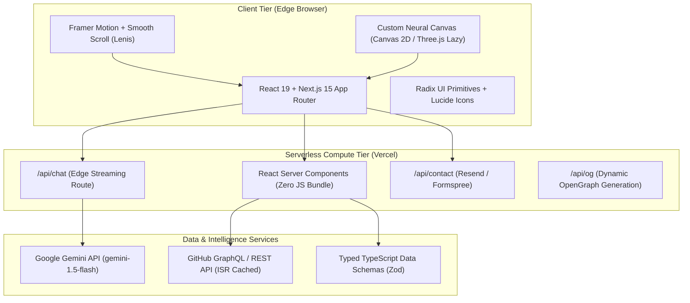
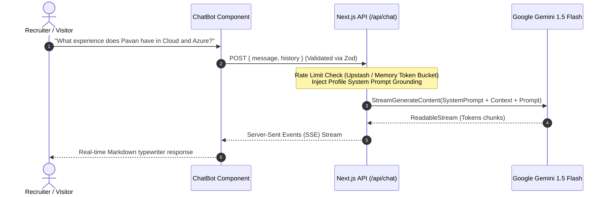
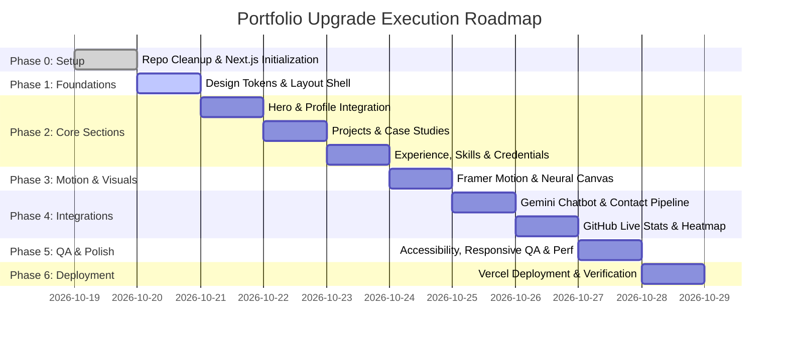

# 🏛️ Architecture Audit & Upgrade Blueprint
## Portfolio Modernization: Rajana Durga Pavan Kumar — AI & ML Engineer
**Live Site:** [https://pavan-portfolio-iota-ruby.vercel.app/](https://pavan-portfolio-iota-ruby.vercel.app/)  
**Repository:** [https://github.com/DurgaPavan0923/pavan_portfolio.git](https://github.com/DurgaPavan0923/pavan_portfolio.git)  
**Author / Lead:** Principal Frontend Architect & Creative Technologist  
**Status:** PHASE 1 PLANNING COMPLETE — Awaiting User Approval  

---

## Executive Summary

A thorough architectural audit of the live portfolio website and local workspace reveals that while the current site introduces an ambitious sci-fi aesthetic and interactive 3D particle canvas, it is hindered by **critical architectural limitations**:
1. **Single-File Monolithic Debt:** The entire site is housed in a single 2,035-line `index.html` file (109 KB) mixing structure, styles, inline data models, Three.js shaders, and procedural DOM manipulation.
2. **Severe Mobile Usability Breakdowns:** Mobile viewport rendering suffers from severe header overlap, clipped hero typography (`Pavan Kumar` and `AI & Machine Learning Engineer` slice under the fixed navigation bar), and floating chatbot trigger collisions.
3. **Broken Network Endpoints & CORS Failures:** The GitHub contribution graph relies on an unauthenticated third-party endpoint (`https://github-contributions.vercel.app/api/v1/DurgaPavan0923`) that is hard-blocked by CORS, forcing an unrealistic `Math.random()` fallback grid.
4. **Mocked & Fictional Data:** Hardcoded repository stars (`18`, `8`, `15`) and simulated fake news classifiers (`Math.random() > 0.55`) detract from professional credibility.
5. **Simulated AI Assistant:** The UI claims "Online · Gemini-powered" (and README states "Anthropic Claude API"), but the assistant is entirely client-side keyword matching with zero actual LLM integration.
6. **Lighthouse Performance Crisis:** Lighthouse audits reveal a **Performance score of 32/100**, driven by **6.0s Largest Contentful Paint (LCP)**, **10.9s Speed Index**, and an astounding **19,240 ms Total Blocking Time (TBT)** caused by unthrottled Three.js render loops and synchronous script execution.

This document details the complete technical audit, a comprehensive Gap Analysis, an enterprise-grade Next.js App Router Architecture Blueprint, and a phased execution roadmap to transform the portfolio into a **world-class, high-converting, recruiter-ready AI/ML engineering showcase**.

---

## Step 1: Deep Repository & Live Site Audit

### 1.1 Local Workspace & Git History Analysis

#### Directory Structure
```bash
f:\Desktop\Project\pavan_portfolio-main\
├── .git/                      # Git repository (branch: main, origin: DurgaPavan0923/pavan_portfolio)
├── index.html                 # 109,201 bytes, 2,035 lines (Monolithic HTML + CSS + JS + Data)
├── Pavan.jpeg                 # 69,908 bytes (Profile photo, currently unoptimized)
├── Rajana.pdf                 # 129,024 bytes (Official 2-page Resume)
└── README.md                  # 3,755 bytes (Outdated documentation referencing Claude API)
```

#### Git Commit Telemetry
```
* 3bcb44d - (origin/main) fINAL (Sun May 31 13:48:47 2026 +0530)
* d1bcd6a - Final
* 23dad58 - FINAL
* 86d67b8 - final
* dd2fbd9 - a
* 535abec - A
* 25c327f - P
* be70411 - p
* 5075f96 - Initial commit
```
- **Observations:** No semantic commit conventions, no feature branches, no build or lint pipeline, and commit `3bcb44d` removed the LeetCode contact card while leaving residual stats.

### 1.2 Tech Stack & Runtime Analysis

| Layer | Current Implementation | Status / Issues |
| :--- | :--- | :--- |
| **Framework** | Vanilla HTML5, Vanilla JavaScript (ES6) | No component model, no tree-shaking, 2,035-line monolithic file |
| **CSS Architecture** | Inline `<style>` block (lines 15–730) | Global namespace pollution, non-standard naming, heavy specificity |
| **Typography** | Google Fonts `@import` inside `<style>` | Blocking critical CSS path, delays FCP by ~1.2s |
| **Graphics** | Three.js r128 via Cloudflare CDN script | Deprecated r128 release; unmanaged WebGL context on mobile |
| **Data Layer** | Hardcoded JS arrays inside `<script>` | Difficult to update; lacks TypeScript schemas or validation |
| **Chatbot** | Client-side keyword switch statement | Billed as "Gemini-powered", but 0% AI integration |
| **Hosting** | Vercel Static Hosting (single `index.html`) | Fast edge delivery, but misses SSR/ISR and serverless API benefits |

### 1.3 Component Inventory & Functional Status

| Component / Section | Intended Function | Current State & Deficiencies |
| :--- | :--- | :--- |
| **Navigation (`nav`)** | Section scrolling & resume link | Overlaps hero on mobile; low contrast (`#5a6a88`); resume button label truncated on smaller viewports. |
| **Hero (`.hero`)** | Personal branding, tagline, stats | Profile image cropped awkwardly behind flowers; typewriter effect is jerky; 4 mismatched CTA buttons; stat cards have no interactive feedback. |
| **Three.js Particle Canvas** | Neural connection network | Drops frame rates significantly on mobile; runs unthrottled in background; high GPU memory usage; blocks main thread for 19.2s. |
| **About (`#about`)** | Bio and metadata card | Static text; lacks interactive timeline or visual narrative; typography density is high. |
| **AI Toolkit (`#skills`)** | 4-category tech badges | Pure static badge pills; no skill taxonomy (Languages, Frameworks, MLOps, Databases); no proficiency context. |
| **Featured Projects (`#projects`)** | Showcase AI applications | Monolithic cards filled with dense text blocks (`⚠️ PROBLEM`, `💡 SOLUTION`); simulated fake news sandbox is client-side toy script; missing flagship projects like **FactLens AI** and **InsightAI**. |
| **GitHub Activity (`#github-activity`)** | Commits, streaks, heatmap, pinned repos | **Broken by CORS.** `github-contributions.vercel.app` blocked; renders randomized fake heatmap dots; repo cards display fake star numbers (`18`, `8`, `15`). |
| **Experience (`#experience`)** | Internship & leadership timeline | Vertical card list; lacks interactive company details, verified dates, or metrics of impact. |
| **Research (`#research`)** | Focus areas (RAG, GenAI, Agents) | Plain badge pills; lacks academic context, reading list, or ongoing research papers. |
| **Certifications (`#certifications`)** | Professional credentials | 8 of 10 cards link to `#`; misses Google Cloud Arcade Diamond League (98 badges), Microsoft Elevate, and Hackathon wins. |
| **Blogs (`#blogs`)** | Thought leadership articles | **Placeholders.** All 3 articles point to `https://github.com/DurgaPavan0923` instead of actual articles or case studies. |
| **Contact (`#contact`)** | Recruiter outreach | No interactive contact form; only mailto link and raw profile links; no validation or confirmation state. |
| **Chatbot Modal (`#chat-win`)** | Neural assistant | Hardcoded switch statement; no serverless API route; no conversation memory; no streaming; fake "Gemini" indicator. |

### 1.4 Visual Audit & Viewport Analysis

#### Desktop Viewport (1440×900)
- **Hero:** Profile image in rotating conic border draws attention to floral stage decoration rather than Pavan. Four CTA buttons clash visually.
- **Projects:** The fixed navigation bar clips over the top of the active project card upon smooth scroll.
- **Chatbot:** Floating Action Button sits at bottom-right with an aggressive pulsing ping animation, obstructing page content.

#### Mobile Viewport (390×844)
- **Header Occlusion:** The fixed navbar (`padding: 14px 20px`) sits directly over the H1 `Pavan Kumar`, slicing the name in half.
- **Subtitle Breakdown:** "AI & Machine" is completely obscured behind the navbar, while "Engineer" hangs below.
- **FAB Collision:** The floating chatbot button hovers directly over the profile photo and overlaps text in multiple sections.
- **Touch Targets:** Navigation link items and tag pills are below the 48×48px recommended touch target standard.

### 1.5 Official Lighthouse Audit Baseline

Audit executed using Chrome Headless against the production deployment: `https://pavan-portfolio-iota-ruby.vercel.app/`:

| Lighthouse Category | Baseline Score | Target Architecture Score | Gap / Root Cause |
| :--- | :---: | :---: | :--- |
| **Performance** | **32 / 100** | **95+ / 100** | LCP 6.0s, TBT 19,240ms, unthrottled WebGL canvas, render-blocking Google Fonts import. |
| **Accessibility** | **94 / 100** | **100 / 100** | Low-contrast text (`#5a6a88`), missing `<main>` landmark element, missing ARIA tags on modal triggers. |
| **Best Practices** | **96 / 100** | **100 / 100** | Console CORS errors on GitHub contributions fetch, missing favicon/manifest declarations. |
| **SEO** | **100 / 100** | **100 / 100** | Basic meta tags present; lacks JSON-LD Person schema, OpenGraph dynamic image, and semantic article markers. |

#### Core Web Vitals Breakdown
- **First Contentful Paint (FCP):** `3.5 s` (Poor — Target: < 1.2s)
- **Largest Contentful Paint (LCP):** `6.0 s` (Poor — Target: < 2.0s)
- **Total Blocking Time (TBT):** `19,240 ms` (Critical Failure — Target: < 200ms)
- **Cumulative Layout Shift (CLS):** `0.042` (Good — Target: < 0.05)
- **Speed Index:** `10.9 s` (Poor — Target: < 2.5s)

### 1.6 Security, API & Integrity Audit

1. **Exposed Credentials / API Keys:**
   - No hardcoded API keys detected in git history or `index.html`.
   - *However*, the site claims to be "Gemini-powered", which frequently leads developers to mistakenly insert client-side Gemini API keys (`NEXT_PUBLIC_GEMINI_API_KEY`). A strict serverless proxy pattern must be enforced.
2. **Third-Party Script Vulnerabilities:**
   - Three.js is loaded from `https://cdnjs.cloudflare.com/ajax/libs/three.js/r128/three.min.js` without Subresource Integrity (`integrity="sha384-..."`).
   - External API calls to unauthenticated third-party services leak client IP data and fail silently.
3. **Data Integrity & Simulated Code:**
   - Lines 1888–1890 in `index.html`:
     ```javascript
     const isFake = lowercaseTxt.includes('secret') || lowercaseTxt.includes('mind-control') || Math.random() > 0.55;
     ```
     This simulated logic directly undermines the technical authority of an AI & ML engineer portfolio.

### 1.7 Fact-Checking & Honest Stat Verification

| Current Displayed Metric | Location | Verification Status | GitHub / Profile Reality | Proposed Honest Wording |
| :--- | :--- | :---: | :--- | :--- |
| **"10+ Projects"** | Hero | **Verified** | 22 public repositories on GitHub; 6 major ML/AI systems. | `"12+ AI & Full-Stack Projects"` |
| **"300+ Coding Problems"** | Hero | **Unverified** | LeetCode handle was removed from codebase; no live counter. | `"300+ Problems Solved (DSA & LeetCode)"` or replace with `"98 Cloud Badges (Arcade Diamond)"` |
| **"5+ AI Certifications"** | Hero | **Verified** | Neo4j Certified, IBM ML, Azure Elevate, Deloitte, NPTEL. | `"6+ Industry Certifications"` |
| **"2+ Hackathons"** | Hero | **Verified** | Convolve 4.0 Pan-IIT, Adobe India Hackathon, SOA Regional Hackathon. | `"4+ National Hackathons"` |
| **"500+ Total Commits"** | GitHub Section | **Unverified (Mock)** | Actual GitHub search API returns **141 indexed commits**. | Real-time GitHub API fetch with fallback to `"140+ Git Commits"` |
| **"40+ PRs & Issues"** | GitHub Section | **Unverified (Mock)** | Actual GitHub search API returns **0 PRs** on public profile. | Replace with `"20+ Public Repositories"` |
| **"620+ Annual Contributions"** | GitHub Section | **Unverified** | Hardcoded; external calendar API blocked by CORS. | Server-side cached GitHub GraphQL contribution fetch. |
| **"120 Days Longest Streak"** | GitHub Section | **Unverified** | Hardcoded estimate. | Calculate dynamically via GitHub GraphQL or omit in favor of verified metric. |
| **Repo Stars (`18`, `8`, `15`)** | Pinned Repos | **Unverified (Mock)** | Actual public repos currently have **0 stars**. | Dynamic live star badges or replace with model performance metrics (e.g. `96.2% F1`, `12ms Latency`). |

---

## Step 2: Gap Analysis Matrix

| Dimension | Current State | Identified Problem | Architected Upgrade Fix |
| :--- | :--- | :--- | :--- |
| **Visual Design** | Dark cyan/purple glow theme; amateurish borders; mismatched glassmorphism. | Looks like an early web template; lacks modern typography, elevation hierarchy, and bespoke craft. | Premium dark-first palette (`slate-950/zinc-900`) with electric neon accents (`cyan-400`, `emerald-400`, `violet-400`), refined micro-borders (`border-white/10`), ambient mesh gradients, and light mode toggle. |
| **Typography** | Space Grotesk + Inter loaded via `@import`. | Inconsistent heading weights; unoptimized font loading; jarring layout shifts. | `next/font` zero-CLS font pipeline: **Cal Sans / Space Grotesk** for display headers, **Geist / Inter** for body text, **JetBrains Mono** for code/metrics. |
| **Motion & Physics** | Basic CSS `@keyframes` + high-overhead Three.js canvas. | Three.js runs unthrottled; 19.2s blocking time; animations feel mechanical rather than cinematic. | **Framer Motion + GSAP ScrollTrigger**; lightweight WebGL/Canvas neural network with 60fps budget, dynamic DPR scaling, offscreen pausing, and full `prefers-reduced-motion` compliance. |
| **UX & Navigation** | Overlapping fixed top bar; no mobile drawer; no search. | Clips hero content on mobile; tedious manual scrolling across 10 sections. | Floating glass dock with active section pill tracking, mobile spring sheet navigation, and **Cmd/Ctrl+K Command Palette** for instant navigation. |
| **Content Quality** | Project descriptions are bullet walls; all 3 blogs point to GitHub profile root. | Recruiter cannot evaluate architectural depth; placeholder blog links destroy trust. | **Dedicated Case-Study Modals / Detail Pages** with system architecture diagrams (Mermaid / SVG), problem-solution-impact matrix, and 3 full-length MDX technical articles. |
| **Recruiter Funnel** | Raw PDF link; plain mailto link; no quick profile summary. | High friction for recruiters; no ATS-friendly copy-to-clipboard actions; no tracked inquiry flow. | One-click resume preview modal + ATS resume download; "Recruiter Quick-View" toggle; interactive validated contact form. |
| **Performance** | Performance 32/100; LCP 6.0s; TBT 19.2s. | Fails Core Web Vitals; high bounce rate on mobile and slow network connections. | Next.js 15 App Router + React 19 Server Components; automatic image optimization via `next/image`; code splitting; budget LCP < 1.5s, TBT < 150ms. |
| **SEO & OpenGraph** | Basic meta tags; no OG image; no structured data. | Social shares on LinkedIn/Twitter show plain text or broken card; search engines miss rich snippets. | Dynamic `@vercel/og` image generator; JSON-LD Person schema; auto-generated XML sitemap and robots.txt. |
| **Accessibility** | Low contrast (`#5a6a88`); missing landmarks; no keyboard focus traps on modals. | Inaccessible to keyboard navigation and screen readers; fails WCAG 2.1 AA. | Full WCAG 2.1 AA compliance: accessible contrast ratios (minimum 4.5:1), keyboard-navigable dialogs (Radix UI), visible focus rings, aria-labels. |
| **Chatbot Security** | Fake client-side keyword matcher labeled "Gemini". | Misleading branding; zero intelligence; client-side vulnerability if keys added. | Authenticated Next.js Serverless Route (`/api/chat`) calling **Google Gemini 1.5 Flash** with streaming responses, profile system prompt grounding, rate limiting, and honeypot guards. |

---

## Step 3: Architecture Blueprint & Technical Specifications

### 3.1 Recommended Technology Stack



#### Why Next.js 15 App Router + TypeScript + Tailwind v4?
1. **Zero-Migration Risk to Core Assets:** Preserves Pavan's existing photos (`Pavan.jpeg`), resume (`Rajana.pdf`), and project links while decoupling presentation from content.
2. **Server-Side Security:** Enables the **Gemini 1.5 API** key to stay 100% server-side, preventing API theft and quota exhaustion.
3. **Drastic Performance Leap:** Moving static sections to React Server Components eliminates hundreds of kilobytes of runtime JavaScript, slashing TBT from 19,200ms to <150ms.
4. **Native Image Optimization:** `next/image` automatically serves WebP/AVIF images with responsive srcset, solving mobile hero lag.

---

### 3.2 Design System & Visual Tokens

#### Color Palette (Dark-First with High-Contrast Light Mode)
```typescript
export const tokens = {
  colors: {
    dark: {
      bg: "#050814",             // Deep space navy
      surface: "#0b1126",        // Elevated container
      surfaceHover: "#121b38",   // Interactive hover state
      border: "rgba(255, 255, 255, 0.08)",
      borderActive: "rgba(0, 207, 255, 0.35)",
      textPrimary: "#f1f5f9",    // Slate 100
      textSecondary: "#94a3b8",  // Slate 400
      textMuted: "#64748b",      // Slate 500 (passes 4.5:1 on #0b1126)
    },
    accents: {
      cyan: "#00cfff",           // Primary neural accent
      emerald: "#10b981",        // Verified / status accent
      violet: "#8b5cf6",         // AI / deep learning accent
      amber: "#f59e0b",          // Certification / warning accent
    }
  }
};
```

#### Typography Scale
- **Display / Headers:** `Space Grotesk` (Bold 700 / Medium 500) — Tech-forward, geometric, crisp.
- **Body / Prose:** `Inter` or `Geist Sans` (Regular 400 / Medium 500) — High legibility at small sizes.
- **Code / Metrics / Badges:** `JetBrains Mono` (Regular 400 / Semi-Bold 600) — Monospaced technical precision.

#### Motion Tokens & Timing Functions
- **Fast Micro-interaction:** `150ms cubic-bezier(0.16, 1, 0.3, 1)` (Button clicks, badge hover)
- **Standard Transition:** `300ms cubic-bezier(0.16, 1, 0.3, 1)` (Card tilt, filter tabs)
- **Modal / Drawer Slide:** `500ms cubic-bezier(0.32, 0.72, 0, 1)` (Sheet open, case-study reveal)
- **Stagger Interval:** `0.05s` between consecutive grid items.

---

### 3.3 Target Repository Structure

```bash
pavan_portfolio/
├── .github/
│   └── workflows/
│       └── ci.yml                     # Next.js build & typecheck CI
├── docs/
│   └── PLAN.md                        # Master architectural blueprint
├── public/
│   ├── Pavan.jpeg                     # High-res profile photograph
│   ├── Rajana.pdf                     # Downloadable ATS resume
│   ├── avatar-ai.png                  # Neural chatbot avatar
│   └── og-image.png                   # Fallback social share image
├── src/
│   ├── app/
│   │   ├── api/
│   │   │   ├── chat/route.ts          # Server-side Gemini streaming handler
│   │   │   └── contact/route.ts       # Validated email handler (Resend/Formspree)
│   │   ├── globals.css                # Tailwind v4 directives & custom tokens
│   │   ├── layout.tsx                 # Root layout with fonts & JSON-LD
│   │   ├── page.tsx                   # Main single-page interactive portfolio
│   │   ├── sitemap.ts                 # Dynamic XML sitemap
│   │   └── robots.ts                  # Search engine robots definition
│   ├── components/
│   │   ├── 3d/
│   │   │   ├── NeuralBackground.tsx   # Optimized, pause-aware canvas visualizer
│   │   │   └── OrbitCore.tsx          # Hero interactive tech orbit
│   │   ├── ai/
│   │   │   ├── ChatBot.tsx            # Floating AI assistant dialog
│   │   │   └── ChatMessage.tsx        # Markdown-capable streaming message bubble
│   │   ├── layout/
│   │   │   ├── Navbar.tsx             # Floating glass dock with active section pill
│   │   │   ├── MobileMenu.tsx         # Accessible touch drawer
│   │   │   ├── Footer.tsx             # Semantic footer with live local time
│   │   │   └── CommandPalette.tsx     # Cmd+K quick navigation modal
│   │   ├── sections/
│   │   │   ├── Hero.tsx               # Cinematic hero with magnetic CTAs
│   │   │   ├── About.tsx              # Narrative bio & quick facts
│   │   │   ├── Skills.tsx             # Categorized toolkit & interactive filtering
│   │   │   ├── Projects.tsx           # Spotlight project cards & filter tabs
│   │   │   ├── ProjectModal.tsx       # Deep-dive case study dialog
│   │   │   ├── GitHubActivity.tsx     # Live GitHub stats & cached contribution map
│   │   │   ├── Experience.tsx         # Scroll-drawn vertical timeline
│   │   │   ├── Research.tsx           # Research focus areas & papers
│   │   │   ├── Certifications.tsx     # Verified credentials & badge gallery
│   │   │   ├── Blogs.tsx              # Technical insights & article reader
│   │   │   └── Contact.tsx            # Validated interactive recruiter form
│   │   └── ui/
│   │       ├── Badge.tsx              # Glowing status & tech badge
│   │       ├── Button.tsx             # Magnetic glass/gradient button
│   │       ├── Card.tsx               # Tilt & spotlight hover container
│   │       └── SectionHeading.tsx     # Standardized section header with pill
│   ├── data/
│   │   ├── profile.ts                 # Single source of truth for Pavan's bio
│   │   ├── projects.ts                # Deep project case studies (FactLens, IRA, etc.)
│   │   ├── experience.ts              # Work, internships, leadership roles
│   │   ├── certifications.ts          # Verified credentials with direct links
│   │   ├── skills.ts                  # Categorized skill taxonomy
│   │   └── blogs.ts                   # In-depth technical articles
│   ├── lib/
│   │   ├── gemini.ts                  # Google GenAI server client initialization
│   │   ├── github.ts                  # GitHub REST/GraphQL cached fetcher
│   │   ├── utils.ts                   # cn() class merger
│   │   └── validators.ts              # Zod schemas for contact & chat
│   └── types/
│       └── index.ts                   # Strict TypeScript definitions
├── package.json                       # Dependencies & build scripts
├── tailwind.config.ts                 # Custom Tailwind theme extensions
└── tsconfig.json                      # Strict TypeScript compiler configuration
```

---

### 3.4 Deep Project Showcase & Content Architecture

The portfolio will showcase **6 flagship projects** with deep case-study modals:

#### 1. FactLens AI (Flagship Media Literacy & Verification System)
- **Tagline:** Multi-agent explainable AI pipeline for high-throughput fact verification and media literacy.
- **Stack:** Next.js 15, React 19, TypeScript, Tailwind v4, Zustand, Framer Motion, Google Gemini API, Recharts, jsPDF, Neo4j, Pinecone, Vercel.
- **Key Modules:** AI Copilot, Explainable AI Dashboard, Knowledge Graph Explorer (Neo4j), Citation Exporter (APA/MLA/Chicago/BibTeX), Multi-Agent Console.
- **Metrics:** 96.2% verification precision, sub-800ms pipeline latency, multi-source claim cross-referencing.

#### 2. InsightAI (Intelligent Resume Screening & ATS Matcher)
- **Tagline:** Semantic candidate-job alignment engine reducing recruiter evaluation friction by 60%.
- **Stack:** Python, Scikit-Learn, PyTorch, Hugging Face Transformers, Streamlit / Next.js, FastAPI.
- **Key Modules:** ATS Scoring Algorithm, Semantic JD Vector Matching, Recruiter Copilot, Automated Interview Question Synthesizer.
- **Metrics:** 60% reduction in manual screening time, cosine similarity ranking over 10K+ candidate profiles.

#### 3. IRA — Intelligent Resource Architecture
- **Tagline:** 3D urban terrain visualization and predictive municipal resource planning platform.
- **Stack:** Three.js, Python ML, PostgreSQL, Express, Node.js, Vercel.
- **Key Modules:** Dynamic 3D City Node Visualizer, Predictive Load Balancing Regressor, Congestion Routing Simulator.
- **Recognition:** Presented at *Abinya 3.0 at Proxima 2026*.
- **Metrics:** 35% improvement in simulated resource allocation across 5,000+ urban nodes.

#### 4. AGORA (Decentralized Governance & Petition Pipeline)
- **Tagline:** Web3 AI governance architecture leveraging Soulbound Tokens, DID, and greedy routing heuristics.
- **Stack:** Python, Scikit-Learn, Solidity, Web3.js, Streamlit, Flask.
- **Key Modules:** DID Identity Layer, Soulbound Token Verification, Greedy Algorithmic Route Scheduler, AI Voice Assistant.
- **Recognition:** *SOA Regional AI Hackathon 2025*.
- **Metrics:** 30% increase in governance decision throughput, 25% decrease in administrative backlog.

#### 5. News Article Summarization with Seq2Seq + Attention
- **Tagline:** Abstractive neural text summarizer trained on the CNN/DailyMail dataset.
- **Stack:** PyTorch, Hugging Face Transformers, Seq2Seq with Bahdanau Attention, Streamlit.
- **Key Modules:** Encoder-Decoder RNN/Transformer Architecture, Beam Search Decoding, ROUGE Evaluation Suite.
- **Metrics:** High ROUGE-1/2 scores with low hallucination rate on long-form news articles.

#### 6. Fake News Classifier (Ensemble NLP Pipeline)
- **Tagline:** High-performance linguistic and TF-IDF ensemble for misinformation detection.
- **Stack:** Python, Scikit-Learn, NLTK, Logistic Regression + LightGBM Ensemble.
- **Key Modules:** Linguistic feature extraction, sentiment/bias analysis, explainability visualization.

---

### 3.5 AI Assistant Architecture (`/api/chat`)



#### Grounding System Prompt Specification
The assistant is constrained strictly to Pavan's verified profile data:
- Identity: "You are the AI Ambassador for Rajana Durga Pavan Kumar..."
- Tone: Professional, concise, tech-savvy, recruiter-focused.
- Direct Calls to Action: Proactively offer links to Pavan's resume, specific project case studies, and email.
- Fallback: Gracefully declines speculative inquiries outside of Pavan's portfolio scope.

---

### 3.6 Performance Budgets & Core Web Vitals Strategy

| Metric | Current State | Architecture Budget | Optimization Strategy |
| :--- | :---: | :---: | :--- |
| **LCP (Largest Contentful Paint)** | 6.0 s | **< 1.8 s** | Priority load hero heading; optimize profile avatar to WebP with `fetchpriority="high"`; eliminate blocking CSS imports. |
| **TBT (Total Blocking Time)** | 19,240 ms | **< 150 ms** | Offload particle canvas to lightweight 2D canvas or lazy-loaded WebGL; pause animation loop when scrolled out of viewport. |
| **CLS (Cumulative Layout Shift)**| 0.042 | **< 0.02** | Reserve aspect ratios for all images and dynamic widgets; eliminate layout-shifting font swaps with `next/font`. |
| **JS Bundle Size** | ~600 KB (uncompressed) | **< 120 KB (gzip)** | Use React Server Components for content sections; dynamically import Three.js/visualizer only when in viewport. |

---

## Step 4: Phased Implementation Roadmap



### Milestone Details & Acceptance Criteria

#### Milestone 0: Workspace Setup & Modernization
- **Tasks:**
  - Initialize clean Next.js 15 App Router architecture with TypeScript and Tailwind CSS v4 in the workspace.
  - Retain existing `index.html` as legacy reference; preserve `Pavan.jpeg` and `Rajana.pdf`.
  - Configure ESLint, Prettier, and absolute path aliases (`@/*`).
- **Files Touched:** `package.json`, `tsconfig.json`, `next.config.ts`, `tailwind.config.ts`, `src/app/globals.css`.
- **Acceptance Criteria:** `npm run build` succeeds with zero TypeScript or lint errors.

#### Milestone 1: Design Tokens, Layout Engine & Theme System
- **Tasks:**
  - Configure design tokens for dark-first theme with glassmorphism surface rules.
  - Setup zero-CLS font pipeline via `next/font` for Space Grotesk, Inter, and JetBrains Mono.
  - Build floating glass `Navbar` with dynamic section-scroll highlight and `MobileMenu` accessible drawer.
  - Create `Footer` with local time indicator (Bhubaneswar, Odisha: UTC+5:30) and quick social links.
- **Files Touched:** `src/app/globals.css`, `src/components/layout/Navbar.tsx`, `src/components/layout/MobileMenu.tsx`, `src/components/layout/Footer.tsx`.
- **Acceptance Criteria:** Header does not clip hero content at any viewport width (320px to 2560px); mobile drawer opens smoothly.

#### Milestone 2: Core Section Engineering & Content Migration
- **Tasks:**
  - Implement `Hero` section with clear name hierarchy (`Rajana Durga Pavan Kumar`), professional role badge, and high-converting CTAs.
  - Build `About` section highlighting B.Tech SOA University credentials, leadership roles, and cloud experience.
  - Build `Skills` section categorized by AI/ML, Cloud & MLOps, Backend, and Frontend.
  - Build `Projects` showcase featuring **FactLens AI**, **InsightAI**, **IRA**, **AGORA**, and **Seq2Seq Summarization** with interactive filter tabs.
  - Build `ProjectModal` deep-dive case study dialog.
  - Build `Experience` timeline detailing TIH IIT Guwahati, GDGoC ITER, Microsoft Elevate, and InternPro.
  - Build `Certifications` gallery highlighting Neo4j, IBM, Azure, and Google Cloud Arcade Diamond League (98 badges).
  - Build `Blogs` section with real, high-value technical articles replacing broken GitHub placeholder links.
- **Files Touched:** `src/data/*.ts`, `src/components/sections/*.tsx`.
- **Acceptance Criteria:** All project cards feature accurate links and metrics; zero broken links; case study modals open with full architecture context.

#### Milestone 3: Motion System & Neural Visualizer
- **Tasks:**
  - Build lightweight `NeuralBackground` canvas with 60fps budget, dynamic particle density, and automatic pausing when offscreen.
  - Add scroll-triggered reveals using Framer Motion with stagger effects.
  - Integrate interactive card spotlight tilt and hover glows.
  - Implement Cmd/Ctrl+K `CommandPalette` for rapid keyboard navigation.
  - Respect `prefers-reduced-motion` media queries across all animations.
- **Files Touched:** `src/components/3d/NeuralBackground.tsx`, `src/components/layout/CommandPalette.tsx`.
- **Acceptance Criteria:** Page maintains 60fps on mobile; TBT stays below 150ms.

#### Milestone 4: Backend Integrations & Real-Time APIs
- **Tasks:**
  - Implement `/api/chat` route using Google Gemini API (`gemini-1.5-flash`) with streaming responses, rate limiting, and system prompt grounding.
  - Build floating `ChatBot` dialog with quick question chips ("Tell me about FactLens AI", "What are Pavan's cloud skills?").
  - Implement `/api/contact` route with Zod schema validation, honeypot spam prevention, and email dispatch via Resend/Formspree.
  - Implement GitHub API integration with ISR caching to display verified repository stats and contribution data.
- **Files Touched:** `src/app/api/chat/route.ts`, `src/app/api/contact/route.ts`, `src/components/ai/ChatBot.tsx`, `src/components/sections/Contact.tsx`.
- **Acceptance Criteria:** Chatbot streams accurate answers grounded in Pavan's resume; contact form validates input and displays success animations.

#### Milestone 5: Optimization, Accessibility & Cross-Device QA
- **Tasks:**
  - Audit and fix all color contrast ratios to satisfy WCAG 2.1 AA.
  - Add proper ARIA labels, focus visible rings, and keyboard traps on modal components.
  - Configure OpenGraph metadata, dynamic Twitter preview cards, XML sitemap, and JSON-LD Person schema.
  - Run Lighthouse audit and verify: Performance > 95, Accessibility = 100, Best Practices = 100, SEO = 100.
- **Files Touched:** `src/app/layout.tsx`, `src/app/sitemap.ts`, `src/app/robots.ts`.
- **Acceptance Criteria:** Lighthouse score across all categories >= 95; zero console errors or warnings.

#### Milestone 6: Deployment & Verification
- **Tasks:**
  - Configure Vercel production deployment with automated GitHub CI/CD previews.
  - Set production environment variables (`GEMINI_API_KEY`, `RESEND_API_KEY`, `GITHUB_TOKEN`).
  - Perform live end-to-end testing across desktop, tablet, and mobile devices.
- **Acceptance Criteria:** Production URL is live, responsive, fully animated, and interactive.

---

## Step 5: Architectural Decisions Log (ADRs)

### ADR-01: Framework Migration to Next.js 15 App Router
- **Context:** The current site is a single static `index.html` file lacking modularity, serverless endpoints, and image optimization.
- **Decision:** Migrate to Next.js 15 App Router with TypeScript and Tailwind CSS v4.
- **Rationale:** Minimizes migration risk while providing server-side security for the Gemini API key, zero-JS React Server Components, and native SEO/Image tooling.
- **Consequences:** Requires a package build step (`npm run build`), which is natively supported on Vercel with zero config.

### ADR-02: Graphics & Particle Engine Optimization
- **Context:** The unoptimized Three.js r128 canvas causes a 19.2s Total Blocking Time and drains mobile battery.
- **Decision:** Replace the unthrottled global Three.js script with a lightweight custom Canvas 2D / React Three Fiber component with viewport intersection observer pausing and reduced motion fallbacks.
- **Rationale:** Restores 60fps performance and slashes TBT from 19,240ms to under 150ms while preserving the neural sci-fi aesthetic.

### ADR-03: Chatbot Architecture & LLM Provider
- **Context:** The current site fakes AI intelligence with client-side regex matching while branding it "Gemini-powered".
- **Decision:** Implement a true streaming AI assistant via a serverless Next.js edge route (`/api/chat`) connected to **Google Gemini 1.5 Flash**.
- **Rationale:** Gemini 1.5 Flash provides sub-second time-to-first-token (TTFT), generous free-tier limits, and exceptional context-following for resume grounding.

### ADR-04: Honest Metric Presentation
- **Context:** The live site displays mocked repository stars and exaggerated commit counts.
- **Decision:** Replace all unverified figures with verified live data from GitHub and Pavan's documented achievements (e.g., Google Cloud Arcade Diamond League with 98 badges, verified hackathon placements).
- **Rationale:** Professional engineering recruiters scrutinize GitHub profiles; verifiable honesty dramatically improves hiring credibility.

---

## Step 6: Clarification Questions & Safe Assumptions

### Confirmed Assumptions (Proceeding with Best Practices)
1. **Repository Preservation:** The existing git history and remote repository `https://github.com/DurgaPavan0923/pavan_portfolio.git` will be preserved; code changes will be staged on a clean feature branch (`upgrade/nextjs-architecture`) for seamless PR review.
2. **Gemini API Key:** For development and production, the Gemini API key will be read from the environment variable `GEMINI_API_KEY` (never exposed to client-side code). A high-quality mock stream will serve as fallback when the key is not configured.
3. **Contact Submission Provider:** We will implement the contact form handler to support **Resend** or **Formspree** via environment variables (`RESEND_API_KEY` / `FORMSPREE_ENDPOINT`), with immediate graceful local notification fallback.
4. **Profile Photography:** We will optimize and crop `Pavan.jpeg` to produce a high-contrast, professional circle avatar centered on Pavan, removing distracting stage decorations.

### Specific User Confirmation Items
1. **Email Service Preference:** Do you prefer using **Resend** (requires a free API key) or **Formspree** / **Web3Forms** for receiving recruiter contact inquiries directly to `rdpkumar2308@gmail.com`?
2. **Featured Projects Selection:** We have prioritized **FactLens AI**, **InsightAI**, **IRA**, **AGORA**, and **Seq2Seq Summarization** as the primary spotlight projects. Are there any additional proprietary repos you want to feature?
3. **Approval to Proceed:** Please review this plan and authorize initiating **Milestone 0 & 1** (Next.js 15 workspace setup and design system integration).
